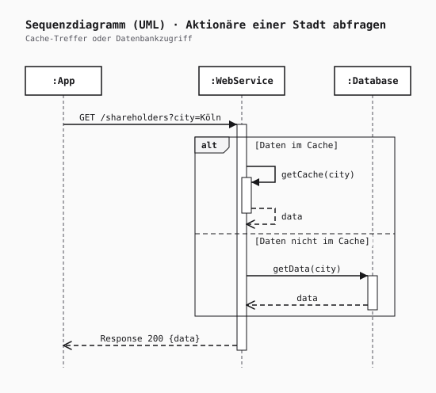
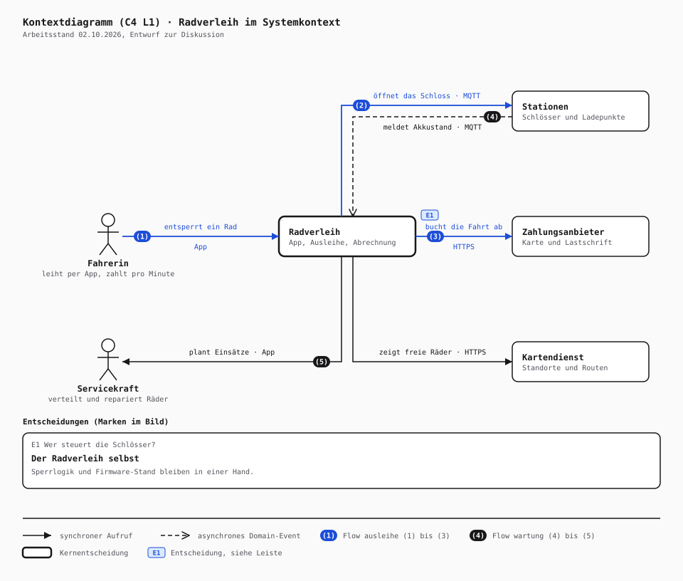

# Diagrist

> Diagrams as code, checked like code.

Diagrist turns small text files (`.dgr`) into diagrams. The language is strict on purpose: every statement,
argument and attribute is listed in a table, a check names what it found and what is allowed, and the same file
always gives the same SVG, byte for byte. Tools like Mermaid, PlantUML and D2 also draw diagrams from text;
Diagrist puts its weight on the checking, so a diagram can be reviewed, diffed and fixed like code.

It is written for two kinds of authors. People who keep diagrams next to their code in git get a formatter, a
check with stable codes and a picture that only changes when the source does. Coding agents get the grammar of
every kind as data, findings as JSON and an agent skill.

**Status:** early. Six diagram kinds work end to end, state machine and class diagrams are being built. Nothing
is published to npm yet, so Diagrist is built from source.

- Website: https://diagrist.com
- License: [Apache-2.0](LICENSE)
- Contributing: [CONTRIBUTING.md](CONTRIBUTING.md)

## What it draws

Each kind comes from a plugin, and each has a page with every statement, its examples and the codes of its rules.

| Kind | Plugin | What it is |
|---|---|---|
| [`sequence`](docs/language/sequence.md) | [`plugin-uml`](plugins/plugin-uml/README.md) | UML sequence diagram (UML 2.5.1, chapter 17) |
| [`usecase`](docs/language/usecase.md) | `plugin-uml` | UML use case diagram (chapter 18) |
| [`activity`](docs/language/activity.md) | `plugin-uml` | UML activity diagram (chapters 15 and 16) |
| [`context`](docs/language/context.md) | [`plugin-architecture`](plugins/plugin-architecture/README.md) | C4 system context diagram (level 1) |
| [`container`](docs/language/container.md) | `plugin-architecture` | C4 container diagram (level 2) |
| [`component`](docs/language/component.md) | `plugin-architecture` | C4 component diagram (level 3) |

UML diagrams are laid out by Diagrist itself. C4 diagrams place their elements in a named grid that the file
declares, so the author decides what stands next to what. State machine and class diagrams are the next kinds of
`plugin-uml`.

How much of UML 2.5.1 the UML kinds cover is not claimed by hand. The tables mark which element of the
specification each statement and rule implements, and the
[coverage report](plugins/plugin-uml/docs/spec-coverage.md) is generated from these marks: per kind the elements
that are covered, the ones that are not, and the example files that use each.

Every kind renders to SVG. `--png` adds a PNG, drawn by resvg compiled to WebAssembly with the bundled fonts, so
it needs no browser and gives the same bytes on every machine.

## Two examples

Both come from the example files in the repository. Most of those are written in German, and `locale=de` in the
header also puts the words the picture adds itself, such as the heading, in German.

A sequence diagram from `plugin-uml`, with an `alt` fragment whose operands are indented below it:

```dgr
# A web service with a cache: a self call with a reply to itself in the first operand, the database call in
# the second.
diagram sequence "Aktionäre einer Stadt abfragen" subtitle="Cache-Treffer oder Datenbankzugriff" locale=de
participant app ":App"
participant ws ":WebService"
participant db ":Database"
msg app -> ws "GET /shareholders?city=Köln"
alt "Daten im Cache"
  msg ws -> ws "getCache(city)"
  msg ws --> ws "data"
  else "Daten nicht im Cache"
    msg ws -> db "getData(city)"
    msg db --> ws "data"
msg ws --> app "Response 200 {data}"
```



A C4 context diagram from `plugin-architecture`. The two `grid` lines name the columns and rows, `at` places each
element, a `flow` numbers the steps of a path, and `adr` explains the mark `E1` in a bar below the picture:

```dgr
# Radverleih, C4 level 1: the system as a black box with the people who use it and the systems around it.
diagram context "Radverleih im Systemkontext" subtitle="Arbeitsstand 02.10.2026, Entwurf zur Diskussion" locale=de
grid cols people,core,partners
grid rows top,main,bottom

person fahrerin  "Fahrerin"         tech="leiht per App, zahlt pro Minute" at people/main
person service   "Servicekraft"     tech="verteilt und repariert Räder"    at people/bottom
system verleih   "Radverleih"       tech="App, Ausleihe, Abrechnung"       at core/main emph mark=E1
system stationen "Stationen"        tech="Schlösser und Ladepunkte"        at partners/top
system zahlung   "Zahlungsanbieter" tech="Karte und Lastschrift"           at partners/main
system karten    "Kartendienst"     tech="Standorte und Routen"            at partners/bottom

flow ausleihe accent
  fahrerin -> verleih   "entsperrt ein Rad" via=App
  verleih  -> stationen "öffnet das Schloss" via=MQTT
  verleih  -> zahlung   "bucht die Fahrt ab" via=HTTPS

flow wartung primary
  stationen ~> verleih "meldet Akkustand" via=MQTT
  verleih   -> service "plant Einsätze" via=App

edge verleih -> karten "zeigt freie Räder" via=HTTPS

adr E1 "Wer steuert die Schlösser?" = "Der Radverleih selbst" => "Sperrlogik und Firmware-Stand bleiben in einer Hand."
```



A mistake is reported with its position, a stable code and what would be correct:

```text
login.dgr:3:23  L105  error: `participant` has no attribute `stereotyp`. Allowed: `stereotype=`, `tone=`.
  participant api "API" stereotyp="service"
                        ^^^^^^^^^^^^^^^^^^^
```

## The command line

The command line is called `dgr` (also `diagrist`) and has five commands. `fmt` formats files in place, `check`
reports every finding, `build` writes the SVG and with `--png` the PNG, `grammar` shows what a kind allows, and
`help` explains the rest. Every command takes `--json` for one JSON document on stdout and `--locale de` for
German messages.

```sh
dgr fmt diagrams/*.dgr
dgr check diagrams/order.dgr
dgr build diagrams/order.dgr --png --scale 3
dgr build diagrams/order.dgr --png --watch
dgr grammar sequence --json
```

`build --watch` builds once and then again each time the file is saved, also by editors that save by renaming a
new file over the old one. Each build prints what it wrote and its findings. An error in the diagram does not end
the watch; the next save builds again. Ctrl+C ends it.

## For agents

`dgr grammar <kind> --json` prints every statement of a kind with its arguments, attributes, flags, doc and
examples as data, and validates against the JSON Schema in [`schemas`](schemas/grammar.schema.json).
`dgr check <file> --json` reports each finding with its code, position and the values its message is built from,
so a tool does not have to parse text.

The agent skill in [`skills/diagrist`](skills/diagrist/SKILL.md) tells an agent how to work with Diagrist: look
the grammar up, write the file, check it until nothing is reported, format it and look at the PNG. It also holds a
short reference of every kind. Copy the folder to where your agent looks for skills.

The language pages, the CLI reference, the JSON Schema and the skill are generated from the same tables that
check the diagrams, so they cannot drift from what Diagrist accepts.

## Building from source

You need Node 22.11 or later and pnpm 11 (Corepack picks the version from `package.json`).

```sh
pnpm install
pnpm build
node packages/cli/dist/main.js build diagrams/order.dgr --png
```

## Where to read on

| Topic | Where |
|---|---|
| The language: how a file is written, every kind, every diagnostic code | [`docs/language`](docs/language/README.md) |
| The command line: commands, options, exit codes, JSON output | [`docs/cli.md`](docs/cli.md) |
| UML 2.5.1 coverage of the UML kinds | [`plugins/plugin-uml/docs/spec-coverage.md`](plugins/plugin-uml/docs/spec-coverage.md) |
| How the code is organised and the rules it follows | [`AGENTS.md`](AGENTS.md), [`docs/engineering.md`](docs/engineering.md) |
| Why it is built this way | [`docs/adr`](docs/adr) |
| Debt we accept on purpose | [`docs/burn-down.md`](docs/burn-down.md) |
